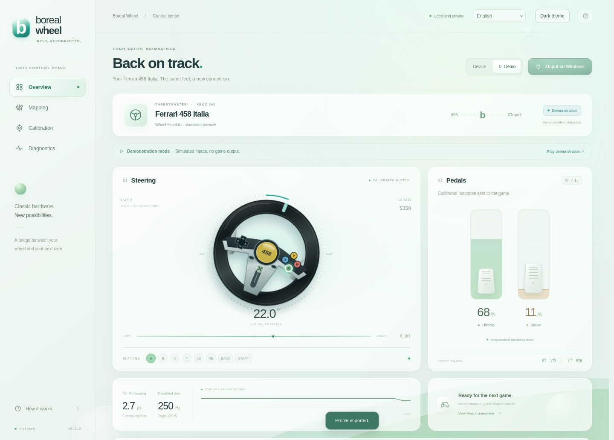

# Boreal Wheel

**English** | [Português (Brasil)](README.pt-BR.md)

**Your wheel, back on track.** A C11 input bridge that lets you use the **Thrustmaster Ferrari 458 Italia for Xbox 360** as a **virtual Xbox 360 / XInput controller** in Windows games. Includes control mapping, visual calibration, portable profiles and a local interface with light and dark themes.

Created by **CaioSaraiva**. Boreal Wheel combines a reference to the steering wheel with the interface's glass and light aesthetic.



## Download and start on Windows

1. Download `boreal-wheel-windows-x64.zip` from [Releases](https://github.com/Caio-Saraiva/boreal-wheel/releases/latest) and **extract everything** to a permanent folder, such as `C:\BorealWheel`.
2. Connect the wheel and check physical input with `Win+R` → `joy.cpl`.
3. Install the [official ViGEmBus driver](https://github.com/nefarius/ViGEmBus/releases/tag/v1.22.0) and restart if requested. The bundled DLL does not replace this driver.
4. Run `run.cmd` and open **http://127.0.0.1:4580**. Select **Device**, check movement and adjust your controls.
5. Configure [HidHide](docs/INSTALLATION.md#configure-hidhide) if the game also detects the physical wheel: allow `boreal-wheel.exe` and hide only the physical device.
6. Click **Enable bridge**. When **Virtual Xbox 360 active** appears, open the game in **controller/gamepad** mode: steering on LX, throttle on RT and brake on LT.

Keep the terminal open while playing. Closing the browser tab does not stop the bridge. Click **Disable bridge** or press `Ctrl+C` in the terminal to stop it. `run-demo.cmd` lets you explore without hardware and blocks game output.

## Languages

**English is the default.** Use the **Language** selector in the top bar to switch to **Português (Brasil)**. Your choice is remembered by the browser, separately from the wheel profile. Switching languages updates the interface without changing controls, calibration, profile codes or the active bridge.

The native process also defaults to English. For Portuguese terminal/API messages, run `boreal-wheel.exe --lang pt-BR`, use `run-pt-BR.cmd`, or pass `-Language pt-BR` to the PowerShell scripts. The browser selector translates supported diagnostic messages in either process language.

## Documentation

| I want to… | English | Português (Brasil) |
| --- | --- | --- |
| Install with ViGEmBus and HidHide | [Installation](docs/INSTALLATION.md) | [Instalação](docs/pt-BR/INSTALLATION.md) |
| Understand every screen and configure controls | [Configuration and calibration](docs/CONFIGURATION.md) | [Configuração e calibração](docs/pt-BR/CONFIGURATION.md) |
| Export, import, share, restore or migrate settings | [Profiles and backups](docs/PROFILES.md) | [Perfis e backups](docs/pt-BR/PROFILES.md) |
| Fix missing input, double input or pedal issues | [Troubleshooting](docs/TROUBLESHOOTING.md) | [Solução de problemas](docs/pt-BR/TROUBLESHOOTING.md) |
| Build, test, package or run on Linux | [Development](docs/DEVELOPMENT.md) | [Desenvolvimento](docs/pt-BR/DEVELOPMENT.md) |
| Automate or inspect the configuration format | [API and profile reference](docs/API.md) | [API e formato do perfil](docs/pt-BR/API.md) |
| Check sources and licenses | [References](docs/REFERENCES.md) · [Third-party notices](THIRD_PARTY_NOTICES.md) | [Referências](docs/pt-BR/REFERENCES.md) · [Avisos](docs/pt-BR/THIRD_PARTY_NOTICES.md) |

## Features and compatibility

- Six analog outputs: LX, LY, RX, RY, RT and LT; 14 buttons/D-pad directions. Available physical axes and buttons can drive any supported output.
- Input identification by movement, pedal swapping and two buttons for the opposite directions of a stick.
- Per-axis deadzone, full-travel limit/sensitivity, response curve, inversion and center; graphs and controls for mouse, touch, numbers and sliders.
- Automatic `profile.ini` saving, JSON or `BW2.` exports, legacy `PB2.` imports and exportable diagnostics.
- Local HTML/CSS/JavaScript interface with no npm dependencies, remote fonts or account. The native core keeps running when the tab is closed.

| Environment | Support |
| --- | --- |
| Windows x64 | XInput 1.4 input, DirectInput 8 fallback, USB diagnostics and virtual ViGEm Xbox 360 output. Windows 11 is the main target. |
| Linux | evdev/xpad input for IDs `24C6:5B00` and `24C6:5B03`, interface and Demo; **no virtual game output**. |
| Other wheels | Detection is not guaranteed. The target is the **458 Italia Xbox 360**, not the 458 Spider Xbox One or TX. |

The game receives a **gamepad**. The application does not add native wheel support, force feedback, the Guide button or sensors missing from the hardware. DirectInput combines the pedals and cannot preserve simultaneous throttle and brake; prefer XInput. The system has up to four XInput slots.

[ViGEm was discontinued by its maintainer](https://docs.nefarius.at/projects/ViGEm/End-of-Life/). Boreal Wheel does not install drivers automatically. The package includes `ViGEmClient.dll` x64; **install ViGEmBus and HidHide separately**. This executable does not have a publisher's digital signature.

## Run from source

```bash
git clone https://github.com/Caio-Saraiva/boreal-wheel.git
cd boreal-wheel
# Linux: install a C compiler and development libraries first
./run.sh --demo
```

On Windows, with Visual Studio/Build Tools, Windows SDK and CMake:

```powershell
.\build-windows.ps1
.\run-windows.ps1
```

See [development](docs/DEVELOPMENT.md) for requirements, language options and alternative builds.

## Version 0.3.0 status

The earlier project had physical-wheel input and in-game use reported on Windows with HidHide. This update adds English-first presentation and Brazilian Portuguese support across the application, native messages, scripts, guides and distribution.

Validation covers C mapping tests, native API integration, both interface languages in real Firefox, responsive layouts and Windows x64 cross-compilation. Screenshots use Demo mode.

**Hardware validation still needed:** this distribution, calibration and profile workflow on Windows with a real wheel and game. Linux tests and compilation do not replace that check.

Code licensed under [MIT](LICENSE). This project is independent of Thrustmaster, Ferrari, Microsoft and Nefarius.
