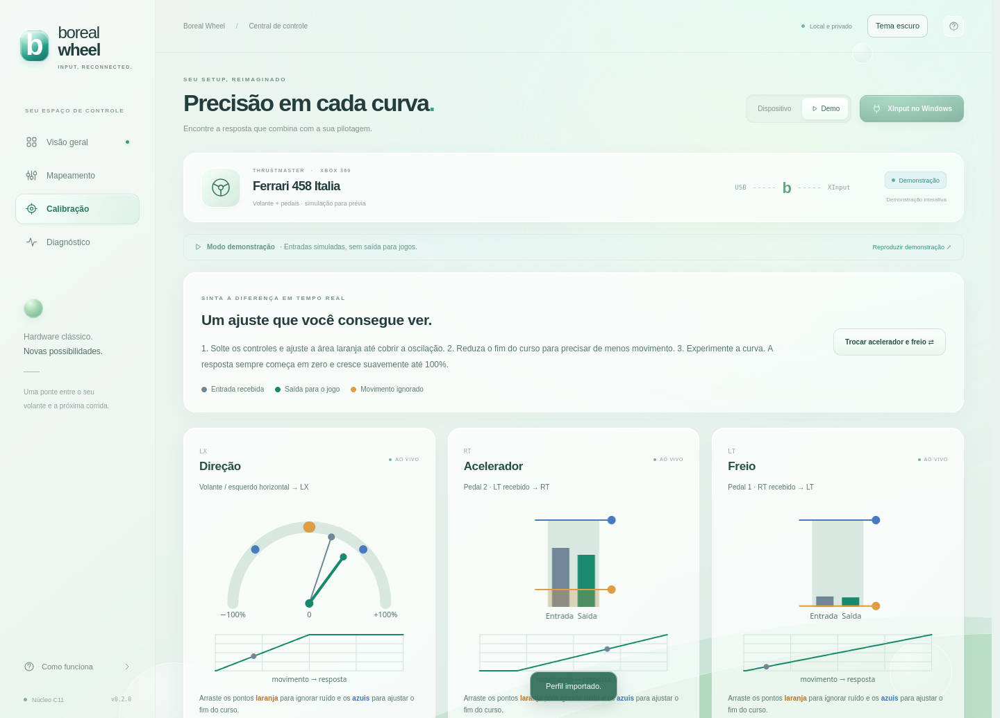

# Configuração e calibração

[Voltar ao README](../README.md) · [Perfis](PERFIS.md) · [Referência de campos](API.md)

Os ajustes válidos são salvos automaticamente em `profile.ini`. Aguarde a indicação de salvamento antes de fechar o processo. Ajustes feitos no navegador são enviados ao núcleo; é o núcleo C que calcula a saída usada pelo jogo.

## Visão geral e modos

- **Dispositivo:** leitura do hardware. Mostra **Entrada detectada**, **USB detectado** sem leitura, ou **Aguardando USB**.
- **Demo:** entradas sintéticas, com saída para jogos bloqueada. **Usar teclado e mouse** alterna a reprodução automática para interação.
- **Ativar ponte / Desativar ponte:** solicita ou remove o controle virtual no Windows. Confirme o resultado em Diagnóstico.
- **Tema claro/escuro:** preferência do navegador, independente do perfil.

Na visão geral, volante, pedais, LX/RT/LT e analógicos representam a **saída calibrada**. A rotação gráfica de ±135° é uma escala visual de 270°, não uma medição em graus do hardware nem uma mudança no curso físico. As luzes dos botões do desenho refletem entradas; os cartões do mapper indicam saídas.

A frequência exibida é a observada no loop C. O tempo em microssegundos mede só a transformação de entrada em relatório; não mede a latência completa entre volante e jogo.

### Explorar a Demo

Clique **Usar teclado e mouse**, tire o foco de campos de texto/sliders e use:

| Controle | Teclas |
| --- | --- |
| Direção | A / D |
| Acelerador / freio | W / S |
| A / B / X / Y do controle | J / K / U / I |
| LB / RB | Q / E |
| D-pad | Setas |

Os sliders também simulam direção, pedais e outros analógicos. O mapper não captura teclado/mouse reais como fontes no modo físico; essas teclas são apenas da Demo.

## Mapeamento: pense na saída para o jogo

Cada cartão corresponde a **um comando recebido pelo jogo**. Em **Receber movimento de** ou **Receber de**, escolha qual entrada física vai comandá-lo. Uma mesma entrada pode alimentar várias saídas.

| Saída | Uso padrão |
| --- | --- |
| LX | Direção, de −100% a +100% |
| LY | Analógico esquerdo vertical |
| RX / RY | Analógico direito horizontal / vertical |
| RT | Acelerador, de 0 a 100% |
| LT | Freio, de 0 a 100% |
| Botões/direcional | D-pad, Start, Back, LS, RS, LB, RB, A, B, X, Y |

### Escolher ou identificar a fonte

Escolha entre os eixos normalizados, botões/direcional e seis eixos brutos disponíveis no backend. Nem todo volante possui todos os controles listados. **Desativado** mantém aquela saída neutra.

Para usar **Identificar**, parta do repouso, clique no botão do cartão e mova somente a entrada desejada. Se outra entrada for identificada por ruído, tente novamente com o dispositivo estabilizado ou selecione a fonte manualmente.

**Trocar acelerador e freio** troca as fontes RT/LT. As calibrações permanecem associadas às saídas; revise-as depois da troca. Esse botão não corrige um pedal que marca 100% solto: para isso confira **Inverter sentido**.

### Botões para controlar um analógico

Nas quatro saídas assinadas LX/LY/RX/RY, escolha um botão como fonte positiva e outro em **Usar duas entradas para os dois lados**. Exemplo: D-pad direito no positivo e esquerdo no negativo para controlar LX. Ambos pressionados se anulam. Só um botão ou pedal como fonte começa em zero e vai ao lado positivo.

### Eixo ou pedal para acionar um botão

No cartão do botão, escolha um eixo/pedal e abra **Limite para eixos / pedais**. Selecione lado positivo ou negativo e a porcentagem de acionamento. Exemplo: RX negativo com limite 60% ativa o botão quando o eixo passa de −0,60. O limiar usa a **fonte de entrada**, não a calibração de outra saída analógica.

Um botão físico fornece 0 ou 1 e normalmente deve usar **Lado positivo / pressionado**. Isso gera uma saída digital; já RT e LT continuam progressivos quando alimentados por eixos/pedais.

## Calibração de cada eixo



Configure primeiro as fontes no Mapeamento. Em **Calibração**, os cartões principais são direção, acelerador e freio. Abra **Calibrar os outros analógicos** para LY/RX/RY. Cada saída tem ajustes próprios.

| Ajuste | Efeito | Limites |
| --- | --- | --- |
| Zona morta | Ignora oscilação próxima ao repouso | 0–60% |
| 100% de saída ao mover | Quanto movimento basta para saturar a saída | 5–100% |
| Curva de resposta | Distribui a sensibilidade no trecho útil | 0,2–3; padrão 1 |
| Inverter sentido | Muda o sentido da fonte selecionada | ligado/desligado |
| Centro | Compensa repouso deslocado | −50% a +50% |

O fim do curso precisa superar a zona morta em **pelo menos 2 pontos percentuais**. Valores inconsistentes são rejeitados.

### Direção passo a passo

1. Deixe o volante reto e solto. Use **Capturar centro** perto do repouso. Capturas além de ±50% são recusadas.
2. Clique **Medir repouso** e mantenha-o solto por aproximadamente 3 segundos. A interface estima a zona morta e uma margem; confira o resultado.
3. Ajuste os pontos laranja no arco para cobrir só o ruído. Zona morta grande demais elimina pequenos movimentos úteis.
4. Ajuste os pontos azuis ou **100% de saída ao mover**. Em 50%, metade do movimento normalizado já produz direção máxima no jogo.
5. Comece com curva **1**. Abaixo de 1, responde mais cedo; acima de 1, o começo fica mais suave.
6. Confira esquerda, centro e direita na entrada e na saída. Depois confira a resposta dentro do jogo, que pode aplicar sua própria curva/zona morta.

**Capturar máximo** usa o movimento atual: mantenha o volante na posição que deseja transformar em 100% ao clicar. Não é uma gravação automática de uma volta completa.

### Pedais passo a passo

1. Solte os dois pedais e confira repouso próximo de zero. Se trocados, use **Trocar acelerador e freio**.
2. Se a leitura diminuir ao pressionar, confira a fonte e **Inverter sentido**. Uma fonte de pedal unipolar invertida para uma saída de pedal usa `1 − entrada`; em eixos assinados a inversão muda o sinal.
3. Ajuste a zona morta pela base laranja da barra ou **Medir repouso**.
4. Pressione um pedal até o ponto desejado e use **Capturar máximo**, ou ajuste o limite azul/número.
5. Faça o mesmo no outro pedal. Teste os dois simultaneamente em XInput.

Um eixo assinado escolhido para RT/LT usa o lado positivo; a inversão permite usar o negativo. O centro dos pedais existe no formato técnico, mas a interface não oferece captura/controle numérico de centro para eles.

### Como o cálculo funciona

Depois da seleção da fonte, combinação negativa, inversão e compensação do centro, o trecho útil é renormalizado:

```text
magnitude = limitar((abs(entrada) − zona_morta) / (fim_do_curso − zona_morta), 0, 1)
saída = magnitude ^ curva  (preservando o sinal nas saídas assinadas)
```

Exemplo: zona morta 10%, fim do curso 50%, curva 1 e entrada 30% produzem saída 50%. Dentro da zona morta a saída é zero; acima do limite, 100%. Não há limiar digital escondido nos pedais.

Os gráficos mostram entrada selecionada após centro/inversão e saída calculada. Linhas laranja marcam a área ignorada; azuis, o limite de saturação. Durante o arraste o desenho responde imediatamente e os ajustes são enviados com intervalo mínimo de 120 ms e ao soltar. Aguarde o salvamento para exportar/encerrar.

## Diagnóstico: fonte e frequência

| Opção | Quando alterar |
| --- | --- |
| Entrada XInput física | Automático prefere subtipo volante; escolha slot 0–3 quando o driver apresenta o volante como gamepad. Reconfira após reconectar dispositivos. |
| Forçar DirectInput | Quando XInput não fornece leitura. Os pedais ficam combinados. |
| Frequência alvo do loop C | 125, 250 (padrão), 500 ou 1000 Hz. Maior frequência pode aumentar CPU sem criar novas amostras USB. |
| Eixo de direção DirectInput | X, Y, Z, RX, RY ou RZ; padrão X. |
| Eixo combinado de pedais DirectInput | Mesmos seis eixos; padrão Z, negativo acelera e positivo freia. |

As opções XInput/DirectInput são específicas do Windows; no Linux a leitura usa evdev/xpad. Os seis eixos brutos e o backend informado ajudam a encontrar a fonte correta.

O botão **Exportar diagnóstico** baixa `boreal-wheel-diagnostico.json` com o estado atual, relatório, configuração, backend e horário. Ele serve para investigação e **não é um arquivo de perfil importável**.

## Restaurar os padrões

Em **Mapeamento → Seu perfil, em um código**, clique **Restaurar padrão** e depois **Confirmar restauração** dentro de 5 segundos. Isso substitui os ajustes e grava os padrões. [Exporte um backup antes](PERFIS.md).

O reset e a importação não desligam automaticamente uma ponte já ativa. Desative-a antes de trocar um conjunto grande de comandos; reative depois de conferir o resultado. O tema também não faz parte do reset do perfil.
